# Workflow model: one Wettkampf, one keyboard loop

- **Status:** User-refined keyboard/focus/autosave requirements; remaining proposals need validation
- **Date:** 2026-11-10
- **Depends on:** [Wettkampf data model](wettkampf-data-model.md)
- **Epic:** [Scope and decision gates](keyboard-first-wettkampf-epic.md)

## 1. Setup and finish may use the mouse

1. Choose **Neuer Wettkampf**.
2. Fill Nummer, Strecke, Lage and Gender; show the generated title.
3. Select/configure the camera and obtain any OS/browser permissions during
   setup. Show a live preview and an explicit ready/error state.
4. Choose **Karten scannen**. Focus enters the capture control.
5. From here until the stack is complete, no pointer action is required.
6. **Stapel beenden** returns to the Wettkampf overview. Use the mouse again
   if desired to create another Wettkampf, resume this one, or export CSV.

Finishing a stack is navigation, not a new permanent “closed” event state.
Users can resume, review drafts and export again. A CSV is a snapshot, not a
flag that freezes the Wettkampf.

## 2. State model

```mermaid
stateDiagram-v2
    [*] --> Overview
    Overview --> Setup: Create or open Wettkampf
    Setup --> CameraReady: Metadata and camera ready
    CameraReady --> Capturing: Explicit shutter key
    Capturing --> Persisting: Frame accepted
    Capturing --> CaptureError: No usable frame or device failure
    CaptureError --> CameraReady: Retry or reconnect
    CaptureError --> FileSelection: Choose keyboard-accessible file fallback
    FileSelection --> Persisting: Accept selected image
    FileSelection --> CaptureError: Cancel or unreadable file
    Persisting --> Review: Image and draft durably saved; start background processing
    Persisting --> SaveError: Image or database write failed
    SaveError --> Persisting: Retry same captured image
    Review --> Review: Background candidates ready, partial, unavailable or cancelled
    Review --> SavingDraft: Autosave change, exit field or leave with save
    SavingDraft --> Review: Saved
    SavingDraft --> Review: Failed, keep dirty values and show error
    Review --> Approving: Explicit approval
    Approving --> CameraReady: Commit succeeds
    Approving --> Review: Commit or validation/concurrency failure
    Review --> RetakeReady: Retake selected; preserve existing draft
    RetakeReady --> Capturing: Explicit shutter key for replacement
    RetakeReady --> Review: Cancel retake; restore existing draft
    CameraReady --> Overview: Finish stack
    Review --> Overview: Save draft and finish stack
    Overview --> Exporting: Export requested
    Exporting --> Overview: Success, cancellation or visible failure
```

This is a UI/application coordination model, not an expansion of persisted
`CardState` for every button press. Persisted lifecycle stays as described in
the [data model](wettkampf-data-model.md#3-review-edits-and-consistency).
File fallback uses the same persistence/processing path. Manual review remains
available when alignment or OCR fails after a valid source image/draft has been
persisted. Never pretend a failed capture produced an image.

## 3. Normal loop and focus

| Step | Screen/action | Focus/result |
|---|---|---|
| Ready | Live camera; Wettkampf header and approved/draft counts stay visible | **Bild aufnehmen** is the focused/active button; `Space` captures |
| Capture | Explicit key takes exactly one frame | Disable/debounce shutter while capture/persistence is in flight |
| Entry transition | Immediately show captured image and entry form; persist image/draft before starting OCR | **Bild erneut aufnehmen** is initially focused/active; do not wait for OCR or show a separate processing page |
| Review/process | Run alignment/OCR in the background on the persisted source; announce progress inline | `Tab` from Retake goes to `Name`; results never steal focus or overwrite edits |
| Edit | Move forward/backward, retain normal text editing | No unexpected focus changes from OCR/status updates |
| Approve | Explicit **Freigeben und nächste Karte** | Commit current values and review status once |
| Next | Success returns to live camera | Focus **Bild aufnehmen**; wait for the next `Space` |

The entry view appears immediately after a usable frame is captured. While its
image/draft is being persisted, fields may be visible but disabled with an
explicit saving state; enable editing as soon as persistence succeeds, without
waiting for OCR. Keep Retake visibly selected throughout. On persistence failure,
show retry/cancel in place rather than letting edits appear durably saved.
Approval is unavailable until processing completes, fails or is explicitly
cancelled to manual review; the user can already edit during processing.

Do not automatically photograph the next card on approval: the user needs time
to replace the physical card. Do not require another navigation command to
reach capture. Do not create an empty next-card record while merely waiting.

Keep the event header visible on both camera and review views:
**Wettkampf 2 · 50 m Rücken · Weiblich**. It is not a series of editable controls
in the routine tab sequence.

### Routine focus and field order

0. **Bild erneut aufnehmen** (initial focus after capture; a button, not a field)
1. Name
2. Vorname
3. Jahrgang
4. Gender: **Mädchen**, then **Junge** (independent tri-state controls)
5. Lauf
6. Bahn
7. Erzielte Zeit
8. Zeitnehmer
9. **Freigeben und nächste Karte**

Gender is part of routine card review, even though the Wettkampf also has a
category. These controls review the card's marks, not the event header. Preserve
checked, unchecked and unknown for each; `Space` must make every state reachable
(proposed cycle: unknown → checked → unchecked → unknown).

Strecke and Lage belong to the Wettkampf and are not routine editable fields.
Their card-side observations/raw OCR remain
available in a keyboard-openable **Kartendetails** section beside the image.
Gender controls are not duplicated there. Tab can enter and leave it normally; opening and
closing it restores a predictable focus location.

This intentionally proposes changing the old paper-order guidance only for the
routine form. Confirm with real use that it saves effort without hiding useful
evidence. The source image and physical card remain available for comparison.

## 4. Keyboard contract

These bindings are a prototype contract, not universal platform guarantees.
Check OS, assistive-technology and browser collisions before adopting them.
Every command also has a labelled, keyboard-reachable control.

| Input | Meaning | Guard |
|---|---|---|
| `Space` | Activate the focused/active button: capture in camera-ready, Retake on initial entry focus, or another focused action | Not a global shutter shortcut; ignore action auto-repeat and require key release across state transitions |
| `Tab` / `Shift+Tab` | Next / previous control | Predictable order; scroll the focused control into view |
| Arrow keys, Home/End, Ctrl+A, clipboard shortcuts | Normal editing or native select/list behavior | Never hijack for card navigation |
| `Space` in fields | Normal text space, or cycle the focused gender mark | Never trigger capture/retake from a text field |
| `Enter` / keypad Enter | Move to the next field/control from an entry field, like `Tab` | Commit current input/selection and autosave on exit; do not globally activate a default button or approve |
| `Enter` on a focused button | Activate that button | A focused Retake/capture button may activate; focus cannot be bypassed by dialog default-button behavior |
| `Ctrl+Enter` | Approve current review and return to capture | Flush current input and wait for pending autosaves; reject duplicate approval, IME composition or a modal dialog; processing must finish or be cancelled first |
| `Ctrl+S` | Save current draft without approval | Stay in review; display saved/failed state |
| `Escape` | Cancel the current dialog; in review/camera offer finish-stack action | Never silently discard a card, close the app or approve |

Retake, processing cancellation, retry, manual fallback, card details, finish
stack, and help must all be reachable through Tab/Shift+Tab and button activation.
They need not each receive a dedicated global shortcut. Retake comes first;
put other secondary controls after the routine approve button, not between
every pair of entry fields. `Ctrl+S` is optional convenience, never necessary
for durability. IME composition and an open selection popup consume their own
confirmation Enter before field traversal occurs.

Disable application-global key handling while a native dialog is active.
Held keys must not carry a shutter event into approval or an approval event
into capture. Browser implementations must scope shortcut handling and prevent
only the specific conflicting default, not all keyboard events.

### Focus and accessibility invariants

- Initial focus is explicit on each state entry; statuses never steal it.
- On a failed save, keep all current values, selection/caret where possible,
  and focus on the relevant error/field or return point.
- Approval is deliberate even for untouched OCR values; tabbing across a field
  does not approve it.
- Show visible focus, labels, shortcut hints and textual status, not just color.
  Announce asynchronous state changes accessibly without moving focus.
- Modal dialogs contain focus and restore it to the invoker. No keyboard trap
  in image controls, details, comboboxes or scrollable forms.
- Image zoom/inspection and any optional crop selection have keyboard controls;
  inspecting the image must not be required to click back into the form.

## 5. Persistence, approval and recovery

**Proposed field policy:** preserve optional fields. A person may explicitly
approve a card containing blanks or unresolved text, with visible inline
warnings and empty canonical values rather than fabricated data. Do not add a
mandatory per-card confirmation dialog. Required fields or blocking validation
would be a separate decision before implementation.

Draft persistence never marks a card reviewed. **Autosave every change**, allowing
debouncing during typing, and **flush at least on every field exit** through
Tab, Shift+Tab, Enter or pointer focus change. Gender changes also autosave.
Queue writes in order per card; a stale queued save must not overwrite newer
input. Flush before navigation, retake, finish-stack or close. Show
dirty/saving/saved/error state; a failed write retains dirty values and an
explicit retryable error. An abrupt crash can lose not-yet-committed keystrokes,
so do not claim perfect recovery of unsaved input.

Approval flushes current values in the same revision-checked transaction that
marks the card reviewed. Do not clear the form or arm the next shutter until
that commit succeeds. On retry after an uncertain response, reload the saved
card ID/revision to avoid duplicate approval or duplicate card creation.

| Situation | Keyboard-reachable recovery | Persistence/focus rule |
|---|---|---|
| Camera missing, permission denied, disconnected | Retry/reconnect or choose file | No invented image or successful capture; setup permissions before the loop where possible |
| Blurred/wrong picture | Initially focused Retake button; `Space` activates it | Return to replacement-camera mode, retain current draft/image until replacement succeeds; confirm replacing existing edits, with cancel available |
| Image copy/DB failure | Retry same in-memory frame or cancel | No OCR before durable image/draft; no new sequence on each retry |
| Alignment unreliable | Retake or proceed to manual review | Keep source; never force mouse-only corner dragging or use guessed crops |
| OCR unavailable/failed/partial | Review manually; optional retry | Explicit status, retain image/candidates; use same field order |
| OCR slow | Cancel to manual review | Saved draft remains; reject obsolete worker results |
| Draft/approval write fails | Retry or stay | Preserve dirty form; never advance or show “approved” |
| Card/event revision stale | Explain conflict, retain local edits, reload/resolve explicitly | No silent last-writer-wins replacement |
| App closed/interrupted | Reopen Wettkampf and saved draft | Interrupted processing becomes needs-review; never auto-approve |
| Finish during review | Save draft and finish, stay, or explicitly discard unsaved changes | Save failure blocks navigation; approved cards remain approved |

### Retake is replacement, not the next card

Propose retaining the same card ID, Wettkampf and sequence during retake.
Activation returns to a live replacement preview with **Bild aufnehmen** focused;
another explicit `Space` captures the replacement. No automatic shutter.
Cancelling returns to the original form with its saved values.

Do not delete the old source first. Persist the replacement image, then atomically
switch the draft's reference, invalidate the old recognition request and clear
source-derived candidates. If user edits exist, require explicit confirmation
before replacing the card's values; do not combine old-photo values with new OCR.
On successful replacement, the entry view again focuses Retake and `Tab` moves
to Name. Failure preserves the original reference/values and exposes retry/cancel.
Cleanup of the superseded managed image is retryable using the existing retention
mechanism. Replacing an approved card requires explicit approval invalidation.

Recognition runs away from the UI thread and returns with card/request identity
and revision. Starting a new card, saving, retrying or leaving a page must not
allow a delayed callback to modify the wrong form or overwrite user input.

Confidence-based Wettkampf warnings are deliberately deferred. A future warning
must preserve this keyboard contract, make evidence inspectable and avoid mouse-only
resolution. No confidence threshold is selected here.

## 6. Finish and CSV

At camera-ready, **Stapel beenden** returns to the Wettkampf overview without
creating another card. From review it first offers save-draft handling.
The overview shows approved/draft totals and offers resume, edit, next Wettkampf
and CSV export.

Mouse use is permitted here, but standard keyboard access should still work.
Apply the proposed [CSV contract](wettkampf-data-model.md#5-proposed-csv-v1-contract):
explain blocked drafts or empty events, let the user choose a local destination,
confirm overwrite and report export success only after the write succeeds.

## 7. Measurable acceptance scenarios

Use synthetic cards and a deterministic recognizer for repeatable UI tests;
repeat hardware checks on the actual camera. The following are acceptance
targets for a prototype, not measured current performance.

| ID | Scenario | Pass condition |
|---|---|---|
| K01 | Setup using mouse, then process 20 cards | Zero pointer actions after entering scan mode; 20 images/cards, correct Wettkampf, no duplicates |
| K02 | Traverse routine fields with Tab/Shift+Tab and Enter | Retake → Name → Vorname → Jahrgang → Mädchen → Junge → Lauf → Bahn → Zeit → Zeitnehmer → Approve; Enter advances from fields, backwards traversal works; focus visible at 100% and 200% text scale |
| K03 | Edit first/last fields, inspect image and details | Keyboard can enter/leave all surfaces and return to the intended field |
| K04 | Enter text/Space/Enter and hold shortcut keys | No accidental approval, capture, extra frame or double save |
| K05 | Approve then replace physical card | Live preview returns; no automatic shutter; next explicit key captures once |
| K06 | Disconnect camera, reject alignment and make OCR unavailable | Retry/import/manual choices work without pointer use; no false success |
| K07 | Fail draft/approval storage | Form and dirty values survive, next capture stays blocked until resolved |
| K08 | Retake with edits; finish with a draft | Keyboard resolves keep/discard/cancel; no silent loss or orphaned managed image |
| K09 | Restart during OCR and after saved edits | Saved card/image/event association and committed edits recover; no automatic approval |
| K10 | Delay worker result until after retry/edit/navigation | Old result cannot change new form or confirmed data |
| K11 | Export synthetic reviewed Wettkampf | Exact agreed CSV headers/rows, canonical units and preserved text; failure/cancel leaves destination intact |
| K12 | Packaged app, offline, on each release OS | Camera permission/reconnect, shortcuts, focus and CSV dialog work without a development environment |
| K13 | Capture with Space while delaying OCR | Entry view appears immediately, Retake initially focused; one Tab reaches Name; late OCR never changes focus or edits |
| K14 | Activate Retake with Space, cancel or capture replacement | Same card/sequence retained; cancel/write failure retains old image/values; successful replacement focuses Retake again |
| K15 | Change each field and gender mark, then exit by Tab/Shift+Tab/Enter | Each exit flushes a draft save without Ctrl+S/approval; restart restores committed edits; failure is visible and dirty values survive |
| K16 | Ctrl+Enter during typing, autosave and delayed processing | Current field included exactly once after safe flush; processing completion or explicit cancellation required; no stale writes after approval; next capture button focused on success |

Measure capture-to-review and approval-to-camera-ready latency (median and p95),
memory, startup time and correction keystrokes on the same fixtures/hardware.
Propose a p95 target of **500 ms from approval commit to camera-ready preview**;
OCR latency is measured separately. Do not select a UI from unsupported
performance claims or visual appearance alone.
