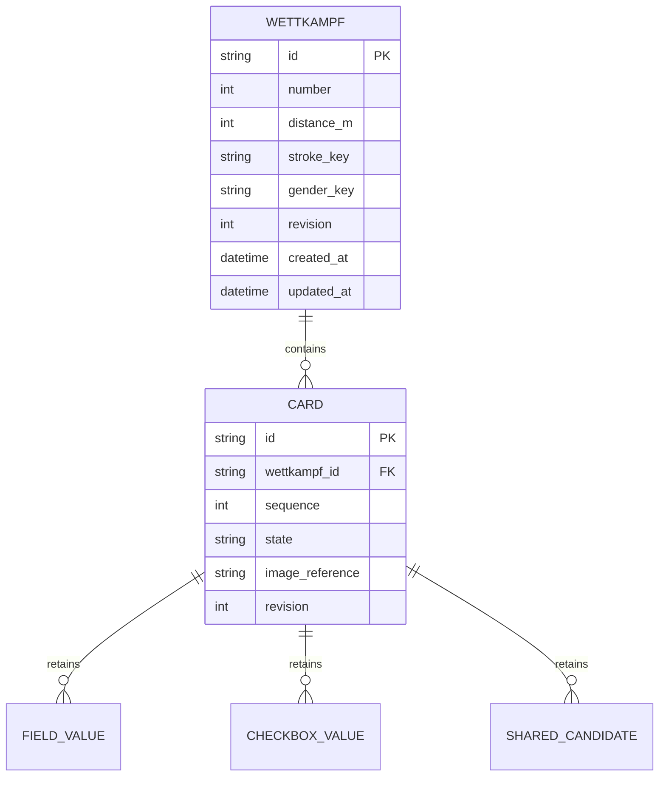

# Proposed data model: Wettkampf owns the event, cards own results

- **Status:** Design baseline; implemented subset and CSV v1 defined in the [takeover plan](browser-mui-implementation.md)
- **Date:** 2026-11-10
- **Scope:** Original logical model and proposals; runtime uses compatible Session records with explicit Wettkampf metadata

Implementation notes: metadata is initially immutable; legacy batches remain
unclassified and cards move explicitly. CSV blocks drafts/empty events and
adds independent `female_mark`/`male_mark` columns to the proposed schema.
The exact implemented contract and deferred features are in the takeover plan;
unimplemented metadata editing and bulk reassignment below remain proposals.

## 1. The domain change

**Sitzung is not a generic batch: it is a Wettkampf.** A Wettkampf has Strecke,
Lage and Gender. Include an explicit number to represent the user's example:

| Attribute | Example |
|---|---|
| Number | `2` |
| Strecke | `50` metres |
| Lage | stable key `ruecken`, displayed as `Rücken` |
| Gender/category | stable key `female`, displayed as `Weiblich` |
| Generated display title | `Wettkampf 2 · 50 m Rücken · Weiblich` |

The generated title is presentation, not an identifier or a string to parse.
Use **Wettkampf** in German UI text, not Sitzung. Domain symbols below are
proposed names; runtime symbols are unchanged in this design phase.

No separate Veranstaltung/meet, swimmer registry, ranking or lane-allocation
model is required to satisfy this epic.

## 2. Relationships



Each new card belongs to exactly one Wettkampf. Its image, field/schema/model/crop
versions, timestamps, state and revision remain as today. One image reference
belongs to its card, not to the Wettkampf header.

### Wettkampf attributes and invariants

| Attribute | Proposed contract |
|---|---|
| `id` | Stable opaque ID; independent of number and translated title |
| `number` | Required positive integer; distinct from card sequence and Lauf |
| `distance_m` | Required positive whole metres; display units are not persisted in the integer |
| `stroke_key` | Required stable option key; creation uses locally configured options |
| `gender_key` | Required stable competition-category key, not two checkbox booleans |
| `revision` | Optimistic concurrency token; increment for metadata changes |
| timestamps | UTC creation/update times |

Propose Weiblich/Männlich as the initial creation choices, reflecting current
card checkboxes; do not assume these exhaust the required event categories.
Mixed/open categories need an explicit product decision and mapping policy.
Reuse the existing recognition-policy aliases for input normalization, but
keep aliases, canonical event keys and German display labels distinct.
Do not invent an exhaustive allowed-distance list.

There is no global uniqueness constraint on the displayed number: numbering
can restart at another meet. With no meet entity yet, flag possible duplicates
in the overview rather than silently reusing/merging an existing Wettkampf.

### Card values: ownership and evidence

| Current persisted key | Role in the proposal |
|---|---|
| `name`, `first_name`, `year` | Per-card swimmer transcription |
| `heat`, `lane` | Per-card positive numeric values when understood, with original text retained |
| `time` | Per-card time transcription plus unambiguous canonical integer milliseconds |
| `timekeeper` | Per-card text |
| `course`, `position` | Card-side Strecke/Lage observations, not the authoritative event header |
| `female`, `male` | Independent tri-state card-mark observations, not Wettkampf category |
| shared `course_position` candidate | Retained legacy evidence; do not split ambiguous text by guessing |

Keep the existing generic field/provenance/confirmation structure. The new
Wettkampf metadata does not justify deleting captured field readings or
rewriting raw OCR with inherited header values.

An effective card's event metadata comes from its Wettkampf; its reviewed
swimmer/result values come from the card. Do not copy the header into every
card as if OCR had read it. Show the header separately in review.

Example: a card in `50 m / Rücken / Weiblich` may have raw `course = "100m"`.
Retain that observation and the source image. It neither changes the Wettkampf
to 100 m nor becomes `50m` in the recognition evidence.

Both gender marks checked, both unchecked, and unreadable marks remain
representable. Never derive one mark by negating the other, or infer a person's
gender from a name. The event category and evidence are different concepts.
Gender stays in the routine review order after Jahrgang: Mädchen, then Junge.
Editing either card mark autosaves the card, not the Wettkampf category.

## 3. Review, edits and consistency

- Retain the current card lifecycle: `CAPTURED → ALIGNING → RECOGNIZING →
  NEEDS_REVIEW → REVIEWED`. Failures remain manually reviewable.
- Approval means a person explicitly approved the current card in the displayed
  Wettkampf context. It does not mean OCR was correct or every value is present.
- Retain raw/corrected text, provenance, confidence where supplied, confirmation
  flags and source regions. Missing confidence is unknown, not zero or certainty.
- Draft saving is distinct from approval. Editing an approved card makes it need
  review again. Late OCR must not overwrite edits or confirmation.
- Autosave every change (debounced while typing), flushing at least on field exit.
  Serialize draft writes with recognition/approval using revisions; autosave
  must not mark a card reviewed or overwrite a later edit.
- Retake proposes replacing the source of the same draft card, not creating the
  next card. Preserve the old reference and values until replacement succeeds;
  invalidate obsolete recognition and require confirmation before resetting edits.
- Capture and approval carry the intended Wettkampf ID; asynchronous work must
  never attach a result to whichever screen happens to be open later.
- Approval checks both the card revision and Wettkampf revision. A stale event
  header must not receive a successful approval.

**Proposed metadata correction rule:** allow event metadata edits with a clear
impact confirmation. Changing number, distance, stroke or category atomically
increments the Wettkampf revision and returns its reviewed cards to
`NEEDS_REVIEW`, retaining their values and images. This prevents a corrected
header from silently changing already-approved exports. This deliberately
conservative rule needs approval before implementation.

**Proposed wrong-stack correction:** explicitly move a card to another existing
Wettkampf from the overview. Preserve its ID/image/evidence, allocate a new
sequence in the destination and invalidate its approval atomically. Do not
silently move cards based on OCR. A keyboard shortcut for this exceptional
action can be designed with the later mismatch-warning policy.

Card sequences are positive and unique within a Wettkampf, allocated transactionally.
Deletion or movement may leave gaps; do not renumber other saved cards.

### Future mismatch warning boundary

Comparison may later read event metadata and card observations. It must not
rewrite either, silently approve/reject, or move a card. Reserve this conceptual
boundary without adding a warning engine, confidence threshold or dismissal
schema now. DE·HTR candidate confidence is not calibrated proof of event identity.
Thresholds, evidence quality and keyboard resolution belong to the later warning
design requested by the user.

## 4. Legacy sessions and persistence migration

Current storage uses database schema version `1`: `sessions`, `cards.session_id`,
generic field values, checkboxes and shared candidates. Old sessions lack event
metadata and may contain several different events.

**Do not turn every old session into a guessed Wettkampf.**

Proposed staged migration for the later implementation:

1. Back up the database and managed-image references using a consistent local
   snapshot; document restoration. Test migration on copies, not live user data.
2. Add the Wettkampf storage and card association in a versioned SQLite migration.
   Keep old session identity/title/time and membership readable for unassigned
   legacy cards. A table rebuild, if needed, must preserve IDs and all dependent
   rows; never use database deletion/recreation as migration.
3. Legacy cards may temporarily have no Wettkampf. This is a migration-only
   exception, visibly labelled **Alte Sitzung – Wettkampf zuordnen**. They remain
   viewable/deletable with all existing evidence and review states.
4. The user explicitly creates/selects a Wettkampf and assigns all or selected
   legacy cards. Mixed sessions can be split. Do not infer metadata from the
   first card or auto-collapse contradictory observations.
5. Assignment preserves card IDs, images, timestamps and provenance; allocate
   destination sequences in prior relative order and invalidate approval because
   the Wettkampf context is newly assigned.
6. Require complete Wettkampf metadata before new capture or CSV export.
   New cards cannot use the legacy unassigned path.
7. Roll back failed database changes, reject unsupported future schema versions,
   and make the assignment operation transactional/retry-safe. No image copying
   or deletion is needed for reassignment.

Use the existing deletion cleanup mechanism for Wettkampf deletion: remove its
cards/evidence and managed images, report pending failures, leave original
imported files and separately exported CSVs untouched. Keep user-controlled
retention; export is not deletion or a backup of images.

Application boundaries become create/list/open/edit/delete Wettkampf, capture or
import into Wettkampf, save draft, approve card, assign/move card, and export
Wettkampf. Reuse repository ports rather than putting SQL into a new front end.

## 5. Proposed CSV v1 contract

The consumer has not been specified. The following is a concrete discussion and
test fixture, **not an approved external interchange format**.

- One user-selected local file for one Wettkampf, one row per card in sequence
  order; repeat authoritative event metadata in each row.
- Propose a header and UTF-8 with BOM, semicolon delimiter and CRLF line endings
  for German spreadsheet use. Use standard CSV quoting for semicolons, quotes
  and embedded newlines; confirm dialect with the actual consumer.
- Use stable, unlocalized headers/enum keys and decimal integers, independent of
  UI locale. Empty means unavailable, never numeric zero or an inferred value.
- Export a consistent database snapshot, not partially saved screen values.
- Initially propose full export only when every remaining card is reviewed.
  Show draft counts and block with a reason; never silently omit drafts.
  Zero cards yields a clear “no cards to export” result, not a misleading file.
- Save through a temporary file beside the destination, flush and atomically
  replace where supported. Confirm overwrite; on cancellation/failure do not
  report success, truncate a pre-existing export or change review states.

Proposed fixed column order:

```text
csv_version;wettkampf_id;wettkampf_number;distance_m;stroke_key;gender_key;card_id;sequence;name;first_name;year_text;heat;heat_text;lane;lane_text;time_ms;time_text;timekeeper
1;wk-example-2;2;50;ruecken;female;card-example-1;1;Mustermann;Maxi;2012;1;1;3;3;42180;0:42,18;Beispiel
```

The example is synthetic. `heat`, `lane` and `time_ms` contain parsed reviewed
values only. Their `*_text` counterparts preserve the reviewed transcription,
including invalid/unresolved text when canonical cells are empty. `year_text`
does not invent a century. OCR evidence and private image paths are not exported.
Missing optional fields remain empty even on explicitly reviewed cards.

**Spreadsheet safety:** quoting alone does not stop formula interpretation.
Propose prefixing an apostrophe to untrusted textual cells whose first
non-whitespace/control character is `=`, `+`, `-` or `@`, or which begin with a
tab/CR/LF. Canonical numeric columns are generated from validated integers.
This intentionally changes affected text in the exported representation only;
stored values remain unchanged. Validate behavior in the target consumer.
If it requires byte-exact text instead, agree a different safe interchange
contract before implementation rather than silently disabling this protection.

## 6. Model and export verification cases

- Create the sample Wettkampf; ID, number and generated title remain distinct.
- Two Wettkämpfe can use the same number without merging cards.
- Reject missing/invalid event metadata for new capture; preserve unknown legacy
  metadata without fabricating a category or distance.
- Preserve `100m` evidence beneath an authoritative `50 m` header.
- Preserve all four clear checkbox combinations and unknown states.
- Concurrent capture cannot reuse a sequence; stale card/event revisions reject
  approval without losing the form.
- Correcting metadata or moving a reviewed card invalidates approval atomically.
- Migrate empty, homogeneous and mixed sessions; preserve IDs, values, images and
  relative order. Test rollback and restart during explicit assignment.
- CSV golden fixtures cover accents, quotes, delimiters, newlines, empty values,
  unresolved years/times, formula-like strings, exact column order and dialect.
- Export tests cover drafts, empty Wettkampf, destination cancellation, existing
  files, disk-full/write failure and a concurrent edit after snapshot creation.
